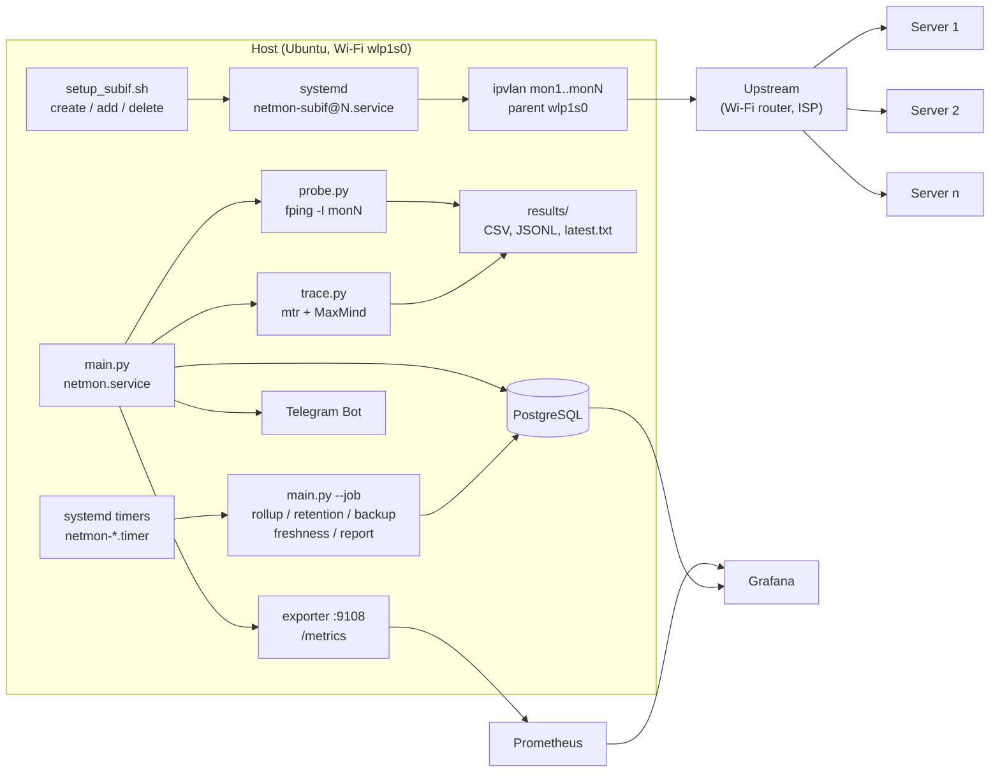
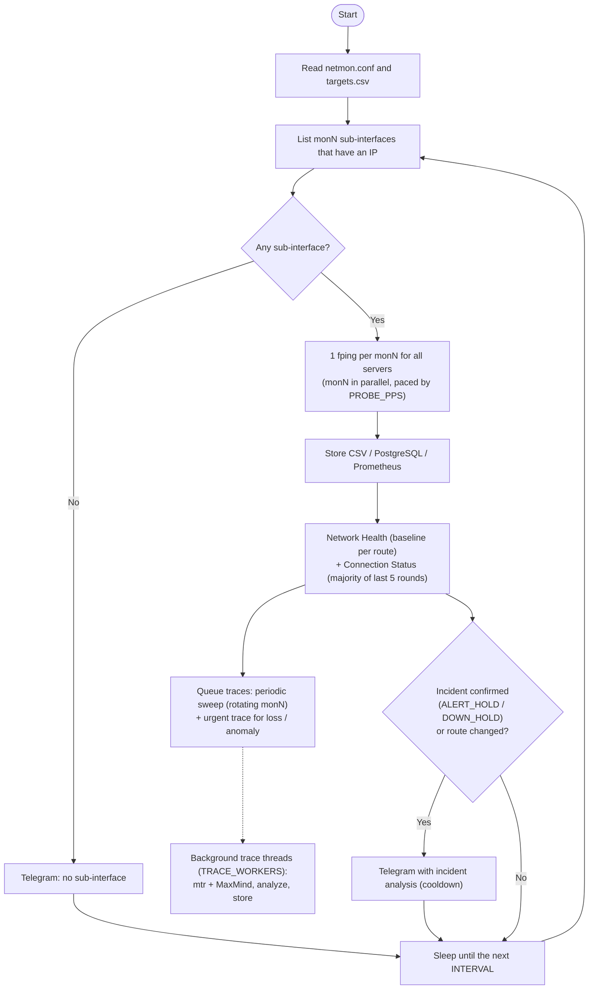
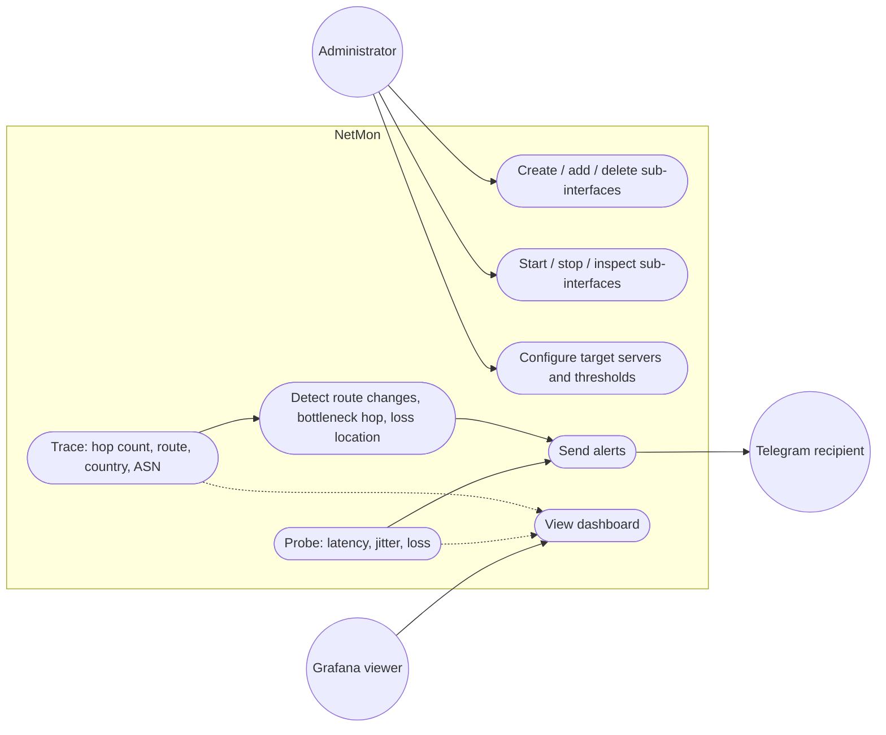
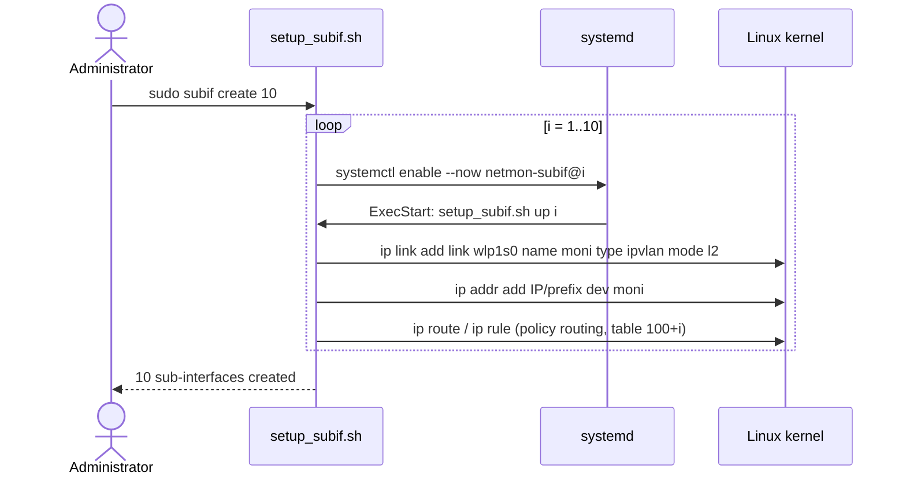
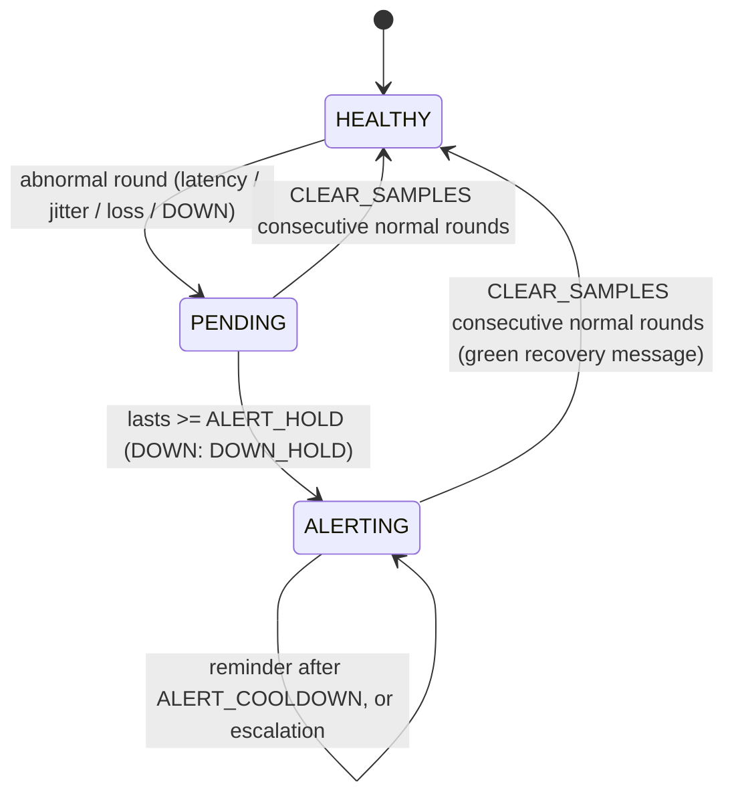
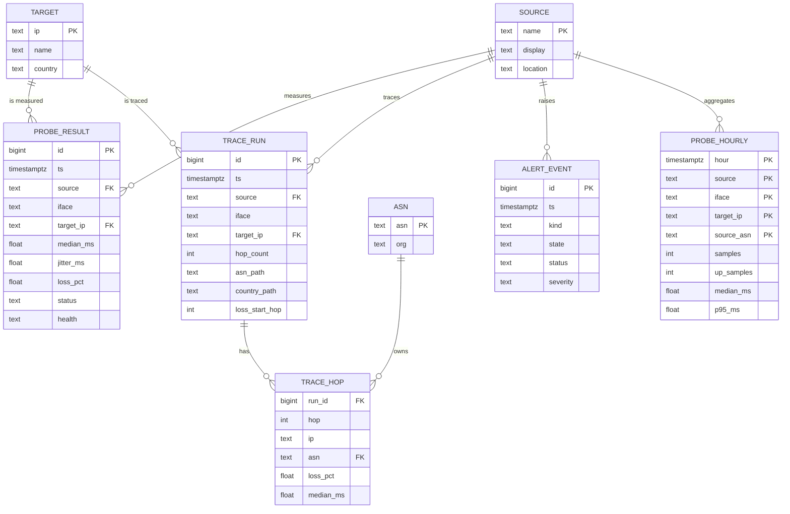

# Router Monitoring System

NetMon – a route measurement and monitoring system.

Measures connection quality and network routes from **1 source (laptop)** to **many target servers**, through **N ipvlan sub-interfaces** created on the Wi-Fi card `wlp1s0`.

| Component | Tool |
|---|---|
| Create/delete sub-interfaces | Bash (`scripts/setup_subif.sh`) + ipvlan |
| Start/stop/inspect sub-interfaces | systemd template unit `netmon-subif@.service` |
| Probe (latency, jitter, loss) | `fping -I` → `monitor/probe.py` |
| Trace (hops, route) | `mtr` → `monitor/trace.py` (background threads) |
| Geolocation + ASN of each hop | MaxMind GeoLite2 (City + ASN) |
| Network Health, Connection Status | `monitor/health.py` (baseline per route, 5-probe majority) |
| Alerts | Telegram Bot (`monitor/alert.py`) |
| Observability | Prometheus + Grafana + PostgreSQL |
| Automation | systemd timers → `monitor/jobs.py` (rollup, retention, backup, freshness, daily report) |

---

## 1. Architecture



**Data flow:** `main.py` finds the `mon*` sub-interfaces present in the kernel → each round it runs **one `fping` per sub-interface** for all servers (the sub-interfaces run in parallel, paced so the total ICMP rate stays within `PROBE_PPS`) → it stores the results, assesses Network Health and the 5-probe Connection Status, updates Prometheus, writes to PostgreSQL and sends Telegram alerts. Traces (`mtr`) run in **background threads**: periodically, rotating the sub-interfaces, and immediately for a pair that shows loss or an anomaly.

## 2. Flowchart of the `main.py` measurement loop



## 3. Use cases



## 4. Sequence: `sudo subif create 10`



## 5. Alert states



## 6. PostgreSQL schema (star schema)



---

## 7. Directory layout

```
.
├── data/                        # GeoLite2-ASN.mmdb, GeoLite2-City.mmdb (download from MaxMind yourself)
├── main.py                      # orchestration: probes, background traces, storage, alerts, --job
├── monitor/
│   ├── probe.py                 # PROBE IP  (fping)
│   ├── trace.py                 # TRACE IP  (mtr + MaxMind)
│   ├── analyze.py               # ASN/country path, bottleneck, signature, loss location, score
│   ├── health.py                # Network Health, Connection Status, alert texts, incident analysis
│   ├── report.py                # terminal / latest.txt output format
│   ├── alert.py                 # Telegram, cooldown, episode tracking, baselines
│   ├── exporter.py              # Prometheus /metrics
│   ├── jobs.py                  # automation jobs run by the systemd timers
│   ├── globalping.py            # optional measurements from Globalping probes in many countries
│   ├── storage.py, schema.sql   # PostgreSQL
│   └── common.py                # configuration, sub-interfaces, measurement source names
├── scripts/
│   ├── setup_subif.sh           # create/add/delete/start/stop/enable/disable/status/list
│   └── 90-netmon-dispatcher     # (optional) rebuild the sub-ifs when Wi-Fi reconnects
├── systemd/                     # netmon.service, netmon-subif@.service, netmon-job@.service, netmon-*.timer
├── etc/                         # netmon.conf, targets.csv (netmon.env is created by install.sh)
├── deploy/                      # Prometheus + Grafana (datasources, dashboard JSON), SQL reports
├── docker-compose.yml           # PostgreSQL + Prometheus + Grafana
├── tests/test_core.py           # unit tests
└── install.sh
```

## 8. Installation and running

```bash
git clone https://github.com/carolivia-chan/Router-Monitoring-System.git netmon && cd netmon
sudo ./install.sh
```

**MaxMind GeoLite2** (free, requires an account at maxmind.com): download `GeoLite2-City.mmdb` and `GeoLite2-ASN.mmdb` into the project's `data/` folder; `install.sh` copies them to `/opt/netmon/data/`. Without them the system still runs, but hops show `Unknown`. The files are not in this repository because the MaxMind license does not allow redistribution.

**Telegram:** create a bot with `@BotFather` to get a token; get the chat id by messaging the bot and opening `https://api.telegram.org/bot<TOKEN>/getUpdates`. Put both in `/etc/netmon/netmon.env` (never commit this file), then test: `sudo /opt/netmon/venv/bin/python /opt/netmon/main.py --test-alert`.

**Sub-interfaces** (see section 9), then a test measurement and the service:

```bash
sudo subif create                                              # create COUNT (=10) sub-interfaces
sudo /opt/netmon/venv/bin/python /opt/netmon/main.py --once    # measure once, print to the screen
sudo systemctl enable --now netmon
systemctl status netmon
systemctl list-timers 'netmon-*'                               # automation jobs
```

**Grafana + Prometheus + PostgreSQL:**

```bash
sudo docker compose up -d
# Grafana: http://localhost:3001 (admin / admin) -> dashboard "NetMon – Route Monitoring"
```
Passwords and ports go in a `.env` file next to `docker-compose.yml` (`PG_PASSWORD`, `PG_PORT` default 5433, `GRAFANA_PASSWORD`) **before** running `install.sh`: install.sh builds `NETMON_PG_DSN` from these values. Then run `sudo systemctl restart netmon` to start storing data in PostgreSQL.

## 9. Sub-interface management commands

| Command | Effect |
|---|---|
| `sudo subif create [N]` | create `mon1..monN` (enable + start) |
| `sudo subif add 11` | add `mon11` only |
| `sudo subif delete 3` / `delete all` | delete (disable + stop) |
| `sudo subif stop 3` / `start 3` / `restart 3` | via systemd |
| `sudo subif disable 3` / `enable 3` | off/on at boot |
| `subif status 3` | = `systemctl status netmon-subif@3` |
| `subif list` | list units and IPs |
| `DRY_RUN=1 subif up 3` | only print the commands it would run |

No source changes needed: change `PARENT`, `COUNT`, `IP_OFFSET`... in `/etc/netmon/netmon.conf`.

## 10. Sample output

```
=== mon1 -> Host 7: 108.61.210.117 (Germany) ===
[probe] latency avg 218.0 ms | jitter 1.8 ms | loss 0% | UP
[trace]
  1  10.28.99.254
  2  *
  5  203.210.148.97   Vietnam    AS45899 VNPT Corp
 12  203.99.9.77      China      Unknown
 13  69.194.165.105   Hong Kong  Unknown
 19  108.61.210.117   Germany    AS20473 The Constant Company, LLC
[analysis] hops=19 | reached=yes | bottleneck=hop 12 (+85.3 ms) | transit: China, Hong Kong | ASN: AS45899 -> AS20473
```
Each round writes `results/latest.txt` (latest version), `probe.csv` and `trace.jsonl`.

## 11. Key techniques

- **Why ipvlan rather than macvlan?** A Wi-Fi access point accepts only 1 MAC address per client. macvlan creates a new MAC for each sub-interface, so the AP rejects it; ipvlan L2 shares the MAC of `wlp1s0` and differs only by IP.
- **Policy routing:** each `monN` has its own routing table (`TABLE_BASE+N`) and rules (`from <ip>`, `oif monN`, plus an `fwmark` rule for mtr's raw sockets) so that `fping -I monN` and `mtr -a <ip>` really leave through monN.
- **Probe pacing:** all monN share 1 public IP (NAT). Sending too many ICMP packets at once makes routers rate-limit ICMP and produces fake loss, so the total rate is capped by `PROBE_PPS` and packets are spread evenly.
- **Network Health:** each (monN, server) pair is compared with its own baseline (Cairo at 300 ms is normal); 1 abnormal metric = DEGRADED, 2 or more = UNSTABLE, no reply = DOWN, measurement error = UNKNOWN (never counted as DOWN).
- **Connection Status:** UP / DOWN by majority over the last 5 probe rounds (>= 3 of 5), so a single bad round does not flip the dashboard.
- **MaxMind for route analysis** in `analyze.py`: (1) country/ASN of each hop; (2) transit countries (e.g. Vietnam → China → Hong Kong → Germany); (3) the hop with the largest latency increase; (4) route changes detected by an ASN+country signature and reported to Telegram; (5) where real packet loss starts (loss that continues to the destination, as opposed to hops that only rate-limit ICMP).
- **Alerts:** one combined message per route (latency + jitter + loss), confirmed only after `ALERT_HOLD` (DOWN: `DOWN_HOLD`), with cooldown, escalation, recovery messages, PATH ISSUE grouping and an automatic incident analysis from the latest trace.
- **Automation (systemd timers):** hourly rollup to `probe_hourly`, daily retention, daily `pg_dump` backup, data freshness check every 2 minutes, daily network report. Every job holds a lock, can be re-run without duplicating data, and logs to journald.

## 12. Known limitations (worth stating in the report)

- All sub-interfaces go through **1 Wi-Fi, 1 router, 1 ISP**, so their routes are usually the same; the `score` differs significantly only with several uplinks or different routes per sub-interface. The system suits stability/repeatability measurements and is a foundation for multiple uplinks later.
- MaxMind **does not optimize routes by itself**; it only provides data for analysis. Its accuracy for infrastructure router IPs is lower than for user IPs (the country may be wrong, the ASN may be `Unknown`).
- Per-hop latency in mtr can be misleading because routers rate-limit ICMP (a slow hop in the middle while later hops are fast): treat the bottleneck hop as a hint, not a conclusion.
- Wi-Fi networks with *client isolation* (public or campus Wi-Fi) may block the sub-interfaces; try a phone hotspot.
- The IPs of `monN` must be outside the DHCP pool; if the router hands out a conflicting address, the script detects it and stops (`arping -D`).
- Switching Wi-Fi networks: the dispatcher rebuilds the sub-interfaces; without NetworkManager, run `sudo subif restart all`.

## 13. Tests

```bash
python3 -m unittest discover -s tests -v    # fping/mtr parsers, analysis, health, alerts, jobs, output format
DRY_RUN=1 scripts/setup_subif.sh up 3       # show the ip commands it would run
```

## 14. Future work

Alertmanager instead of the custom alerting; several uplinks (Wi-Fi + 4G) with different routes per sub-interface; a hop map on the dashboard; or moving `probe_result` to TimescaleDB.
